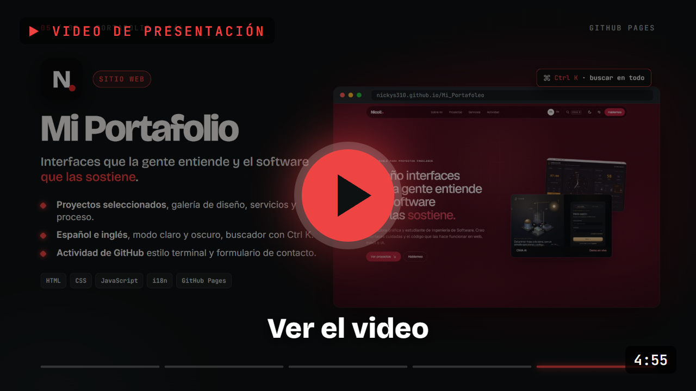

# Mi Portafolio · Nicoll Valentina

## 🎬 Video de presentación (4:55)

[](video/Portafolio_presentacion.mp4)

**[▶ Ver el video de Mi Portafolio](video/Portafolio_presentacion.mp4)**: qué problema resuelve, qué hace, una demo, la arquitectura, la calidad y los aprendizajes. Narrado por Nicoll Valentina.

Diseño interfaces que la gente entiende y el software que las sostiene.

- **Sitio publicado:** https://nickys310.github.io/Mi_Portafoleo/
- **Hecho con:** HTML, CSS y JavaScript puros. Todo el contenido, en español e inglés, sale de `js/content.js`.

## Estructura

```
index.html      página única
css/style.css   estilos (modo claro y oscuro)
js/content.js   textos, proyectos y datos (ES / EN)
js/script.js    secciones, animaciones, casos de estudio y GitHub en vivo
js/extras.js    paleta Ctrl K, terminal, formulario y panel de control
assets/         foto, CV y capturas de los proyectos
video/          video de presentación
```
